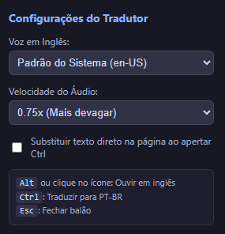
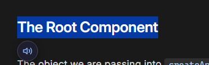
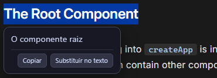

# Nome da Extensão

Extensão para Google Chrome que permite selecionar qualquer texto em uma página web para traduzir ou ouvir a pronúncia sem sair do contexto da leitura.

## Capturas de Tela

### Popup de configuração

### Popup escutar pronúncia

### Popup traduzido

## Funcionalidades
- Traduz textos e parágrafos utilizando a API do Google Tradutor e exibe a tradução em um popup ou substitui o texto original pelo texto traduzido automaticamente.
- Escutar a pronúncia de palavras ou textos em inglês.
- Escolha do tipo de voz do tradutor.

## Como rodar o projeto
1. Clone o repositório e acesse a pasta do projeto.
2. Abra o Google Chrome e acesse `chrome://extensions/` na barra de endereços.
3. Ative o **Modo do desenvolvedor** (*Developer mode*) no canto superior direito.
4. Clique em **Carregar sem compactação** (*Load unpacked*) e selecione a pasta raiz (ou a pasta `dist`/`build`, caso o projeto use compilação) da extensão.